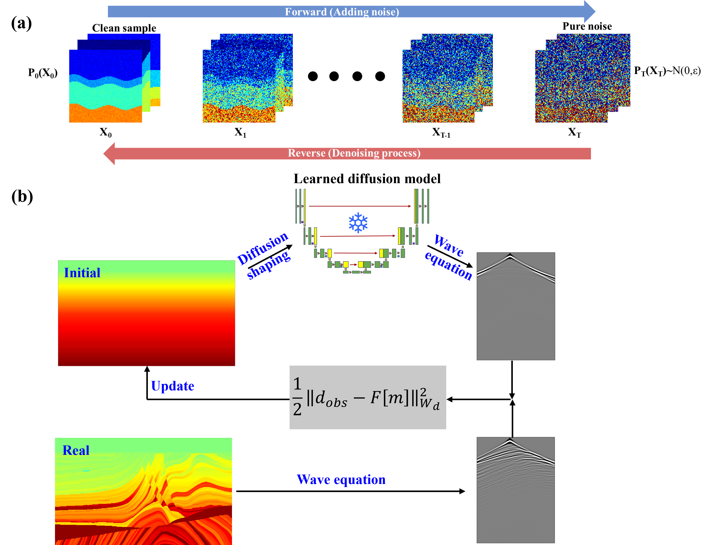
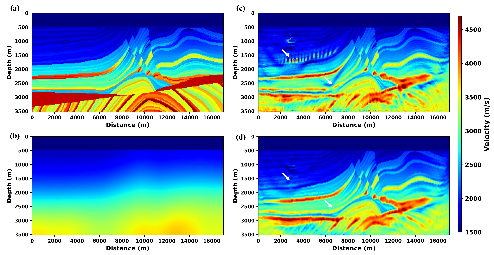
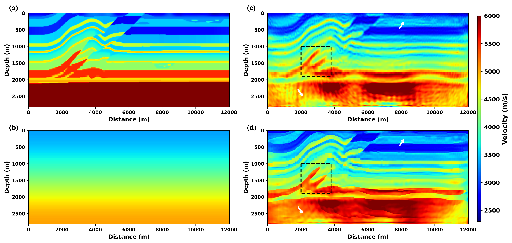

# <div align="center">

# Learned diffusion model regularization for full waveform inversion
**Chao Li**<sup>1</sup> &nbsp;&nbsp;
**Yangkang Chen**<sup>1</sup>

<sup>1</sup> Bureau of Economic Geology, John A. and Katherine G. Jackson School of Geosciences, The University of Texas at Austin  


</div>

---

## Abstract

The diffusion model (DM) is a class of deep generative frameworks that learn the distribution of complex data by iteratively denoising from stochastic perturbations. Here, we introduce a DM-based regularization strategy for full-waveform inversion (FWI), named DM-FWI, which leverages knowledge embedded in an extensive collection of geologic velocity models to train a generalizable model for applying geological priors in a seamless manner. DM's ability to capture high-dimensional structures and generate geologically plausible samples makes it a powerful prior for inverse problems. Within FWI, the DM serves as a structure-adapted smoother, guiding updates toward solutions consistent with realistic geologic patterns. This implicit regularization improves the geological significance of recovered velocity models while alleviating common cycle-skipping issues. Synthetic and field data experiments demonstrate that DM-FWI stabilizes inversion, enhances convergence, and yields subsurface models that are both quantitatively accurate and geologically interpretable.

---

## Framework

<p align="center">
  
</p>

<p align="center">
  <b>Figure 1.</b> (a) The forward and backward diffusion process. (b) Overview of the proposed DMFWI framework.
</p>

The workflow of DMFWI consists of the following main steps:

1. Generate synthetic seismic data from the current velocity model.
2. Use a deep-learning-based matching module to generate extended synthetic data.
3. Compute the misfit between extended synthetic data and observed data.
4. Backpropagate the misfit to update the velocity model iteratively.
5. Refine the updated model using the pretriained difusion model.

---

## Documents demonstration

- The Marmousi folder contains necessary code to reproduce the Marmousi result (main_dlawi.ipynb is ready to visialize the prilimary results).
- The Overthrus folder contains necessary code to reproduce the Overthrust result (main_dlawi.ipynb is ready to visialize the prilimary results).
- For classic AWI, please refer to Warner and Guasch, 2016, Adaptive waveform inversion: Theory, Geophysics, 81 (6): R429–R445.
- For SiameseFWI, please refer to Saad et al., 2024, SiameseFWI: A deep learning network for enhanced full waveform inversion. Journal of Geophysical Research: Machine Learning and Computation, 1, e2024JH000227.


---


## Result

<p align="center">
  
</p>

<p align="center">
  <b>Figure 2.</b> Inverted Marmousi result of (a) Classic FWI, (b) Classic AWI, (c) SiameseFWI, and (d) DL-AWI. 
</p>

<p align="center">
  
</p>

<p align="center">
  <b>Figure 3.</b> Inverted Overthrust result of (a) Classic FWI, (b) Classic AWI, (c) SiameseFWI, and (d) DL-AWI. 
</p>

---

## Features

- Robust against cycle skipping
- Improves inversion with poor initial models
- Compatible with conventional FWI workflows
- Free of complex adjoint source and gradient derivation and calculation.
- Easy to extend to acoustic, viscoacoustic, and elastic settings

---

## Installation

To set up the environment, run:

```bash
conda env create -f environment.yml
conda activate your_env_name
```

---

## Reference 

> Li et al., Learned diffusion model regularization for full waveform inversion.

### BibTex

```bibtex
@Article{lidmfwi,
AUTHOR = {Li, Chao and Chen, Yangkang},
TITLE = {Learned diffusion model regularization for full waveform inversion},
JOURNAL = {Geophysical prospecting},
VOLUME = {submitted}
}


```


